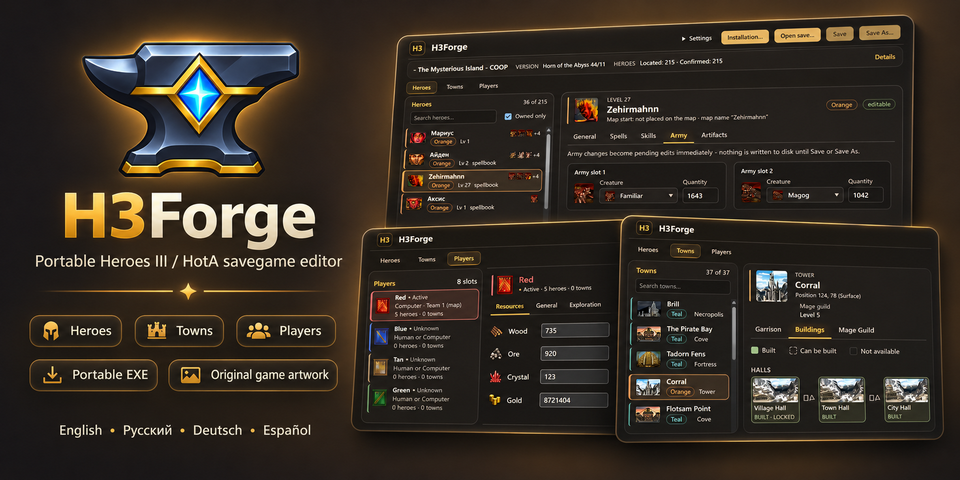
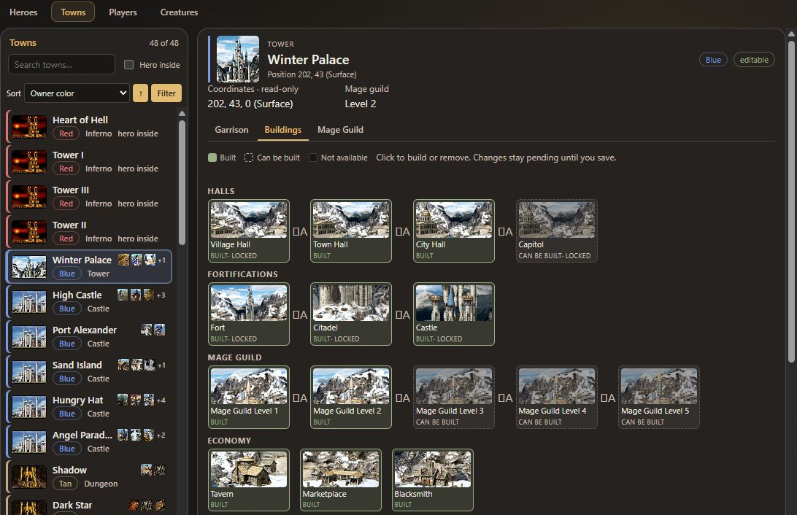
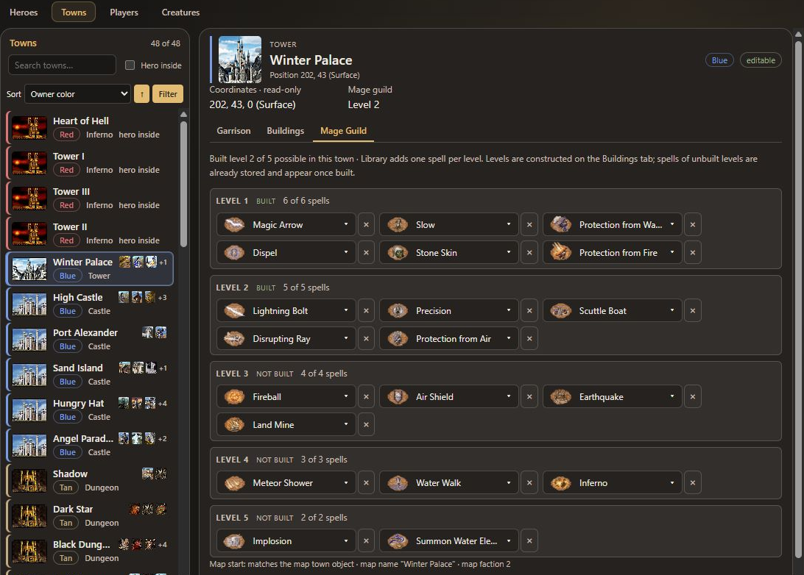
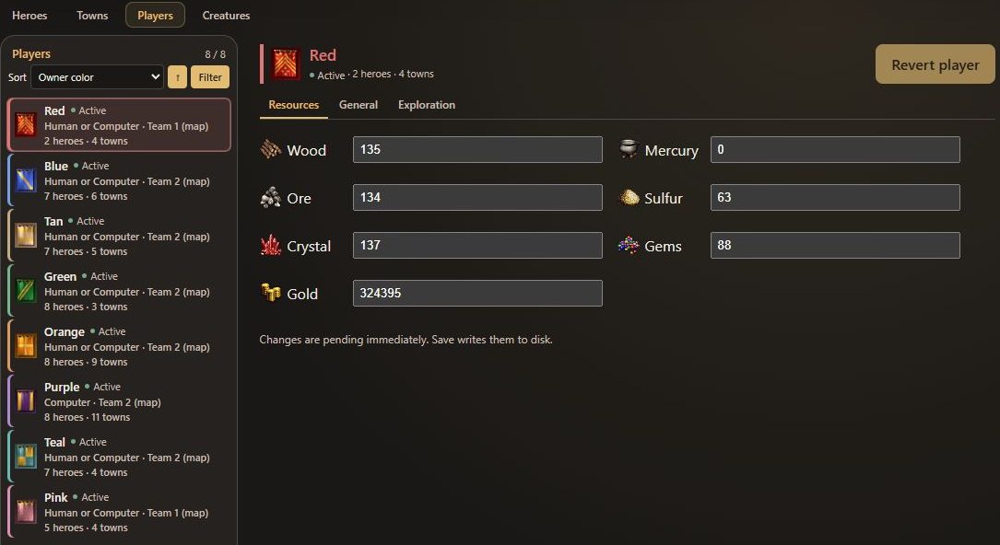
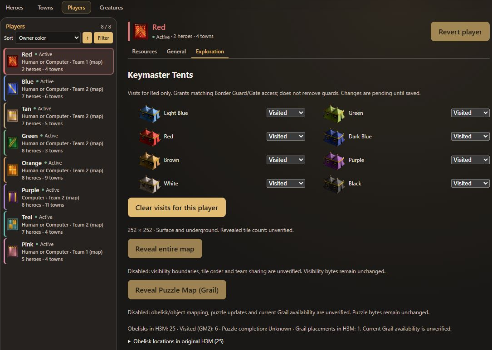
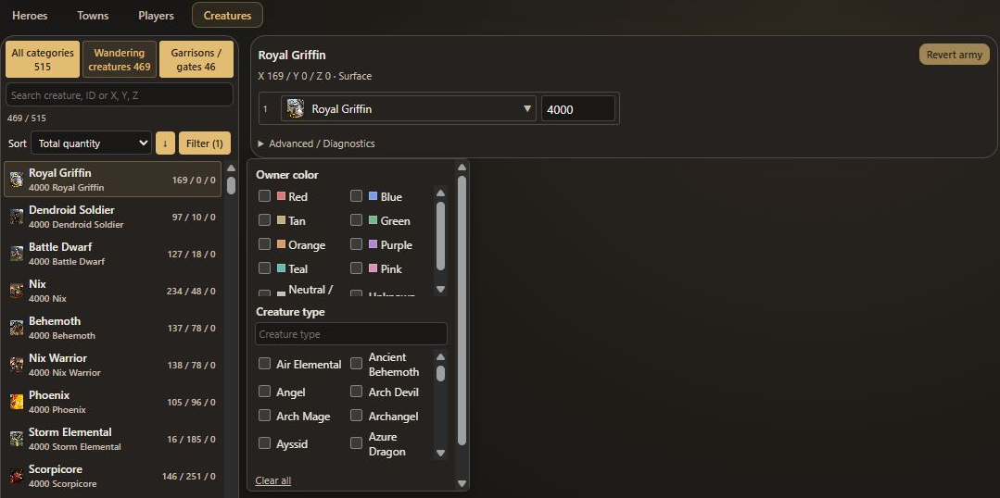

<p align="center">
  
</p>

# H3Forge

**Your heroes, towns, players and creatures. Your next adventure.**

H3Forge is a portable Windows save editor for **Heroes of Might and Magic III / Horn of the Abyss**. Browse your save, adjust supported heroes, towns, player resources and map armies, and save your changes with automatic backups.

## [Download Latest Version](https://github.com/WiverNz/h3forge/releases/latest/download/H3Forge.exe)

**Windows 10/11 x64 · One portable EXE · No installer**

[All releases](https://github.com/WiverNz/h3forge/releases) · [Release notes and limitations](docs/RELEASE_NOTES.md) · [Backup and recovery guide](docs/RELEASE.md#running-and-recovery)

The direct download requires a published release containing `H3Forge.exe`; it becomes available when that asset is first released.

> **Preview:** editing is verified against sample HotA saves, but loading edited saves in the matching game is still awaiting manual verification. Start with a copy of your save and keep your backups.

## What can I do with H3Forge?

| Area | Available on supported saves | Partial or read-only |
|---|---|---|
| **Heroes** | Edit primary attributes, experience and level, spell points, learned spells, secondary skills, army stacks, backpack artifacts and supported equipment. Relocate or dismiss heroes in verified cases. | Movement points are read-only. Relocation requires a validated destination on the same level and land/water medium. Dismissal, equipment and unknown items have operation-specific restrictions. |
| **Towns** | Inspect towns, edit supported garrisons, change verified buildings and edit Mage Guild spells. A garrisoned hero's army can be edited as the town garrison. | Building support is partial. Fort, Citadel, Castle, Capitol, grail and structures with unverified saved state stay locked. Coordinates are read-only. |
| **Players** | Edit gold and all six other resources for verified active players; change Keymaster Tent visit flags for each player and tent color; browse player, hero and town information. | General information and obelisk visits are read-only. Map setup is distinguished from current save state; alliance changes and map revelation are not implemented. |
| **Creatures** | Browse current wandering groups and map garrisons. Edit verified quantities, compatible wandering creature types and supported seven-slot garrison armies. | Other guarded objects and ambiguous records remain unsupported. Original map data is reference-only, not a substitute for current save state. |

- **The look of Heroes III:** portraits, creatures, artifacts, spells and town artwork load from your own game installation. No game archives or extracted artwork are bundled.
- **Save your way:** use **Save** or **Save As**, with automatic backups and verification before the result replaces a file. Changes stay pending until you save.
- **Automatic map discovery:** finds and matches local map files to enrich hero, town and player information. You can choose a map manually when needed; this is not a map editor.
- **Four interface languages:** English, Russian, German and Spanish, selectable in **Settings**. Original save names and some game catalogs retain their original language.
- **Light, dark or system theme:** choose the appearance in Settings.
- **Find things quickly:** consistent ascending/descending sorting and instant filters across all four lists, including multi-select owner colors and locale-aware names. Combine filters with available search, see filtered totals, and clear filters without resetting search or sorting. Sort preferences persist; selections and pending edits survive list changes.

## See it in action

Actual screenshots from the native Windows app **0.1.7**, captured on **2026-11-13** with the English interface, dark theme and a disposable copy of the current sample save. Game artwork is read from the local installation. Locked controls remain visible where an operation is unsupported. [Capture details](docs/screenshots/README.md).

### Heroes and armies

Browse Moandor's seven army slots and the owned-hero list with Sort and Filter controls. Attributes, spells, skills and artifacts have their own tabs. General also offers constrained relocation and dismissal where verified.


### Town buildings

See what is built, what can be built and which structures remain locked.



### Mage Guild spells

Inspect and edit the spell lists for each supported guild level.



### Players and resources

View player status and map information alongside editable resource totals.



### Keymaster Tent visits

Inspect and change each player's visits to all eight tent colors. Map and puzzle revelation remain disabled.



### Creatures and map garrisons

Browse current groups by creature, quantity or coordinates. Filter by owner, creature type, category and map level. The compact filter menu opens beside the list so results stay visible.



## Download, copy, play

1. [Download **H3Forge.exe**](https://github.com/WiverNz/h3forge/releases/latest/download/H3Forge.exe).
2. Copy it into your **Heroes III / Horn of the Abyss installation directory**, beside the game executable.
3. Run **H3Forge.exe**. No installer is required.
4. Choose **Open save…**, open a copy of a savegame and start editing supported fields. Use **Save As…** to keep a separate result.

Prefer another folder? H3Forge can run from there too: use **Installation…** to select your game installation manually.

**Windows prerequisite:** Microsoft Edge **WebView2 Runtime** must be installed. H3Forge does not bundle or install it. You do not need Python, Node.js, Rust, mmarch or a separate frontend folder to run the EXE.

Keep the original save and its backups until you have checked the edited result in the matching game. See the [recovery instructions](docs/RELEASE.md#running-and-recovery) if you need to restore a backup.

## Supported saves and current limitations

The current editable format is the **verified HotA 44/11 save layout**. This is a save-format identifier, not a claim that every Heroes III or HotA release is supported. H3Forge checks individual records and operations before allowing edits; recognizing a save does not automatically make it editable.

- Other layouts, ambiguous records and unknown values may be readable but remain unsupported for editing. There is no blanket editing guarantee for Restoration of Erathia, Armageddon's Blade, Shadow of Death or other HotA layouts.
- Some buildings, equipment, dismissal and map-army operations remain restricted, as described above. Hero relocation is constrained; town relocation, cross-level hero moves, boarding/landing and map revelation are not supported.
- Missing or unsupported game resources can produce placeholders. Some extended hero portrait assignments are inferred; LZMA-compressed HotA resources are not supported.
- Native clean-machine Windows 10/11 checks, human translation review and matching-game load checks remain release gates. A successful save/reopen check is not proof of in-game compatibility.

See the [current release notes](docs/RELEASE_NOTES.md) and [feature status](docs/issues/README.md) for the detailed scope.

## For developers

H3Forge uses **Rust 1.99.1, Tauri 3 Alpha, React, TypeScript and Vite**. On Windows, install the MSVC C++ Build Tools, the pinned Rust toolchain, Node.js 24.13.0 and WebView2 Runtime. From the repository root:

```powershell
npm.cmd --prefix web ci --cache .local/npm-cache
cargo fetch --locked
npm.cmd --prefix web run desktop:dev

# Build and inspect the portable EXE without publishing
.\scripts\build-portable.ps1
node scripts/verify-portable.cjs
```

The build produces `.local/release/H3Forge.exe` and its SHA-256 checksum.

[Developer setup and dependency pins](docs/DEVELOPMENT.md) · [Release process](docs/RELEASE.md) · [Architecture](docs/ARCHITECTURE.md)

Format references: [savegames](docs/formats/SAVEGAME_FORMAT.md) · [game resources](docs/formats/GAME_RESOURCES_FORMAT.md) · [maps](docs/formats/MAP_FORMAT.md).

## License and acknowledgments

H3Forge is distributed under the [MIT license](LICENSE). See [third-party notices](THIRD_PARTY_NOTICES.md) and [retained licenses](licenses/) for the projects whose work it uses or adapts.

Heroes III and Horn of the Abyss belong to their respective creators. H3Forge does not include the games, their archives or extracted artwork. Screenshots show the application displaying resources from an existing installation.
