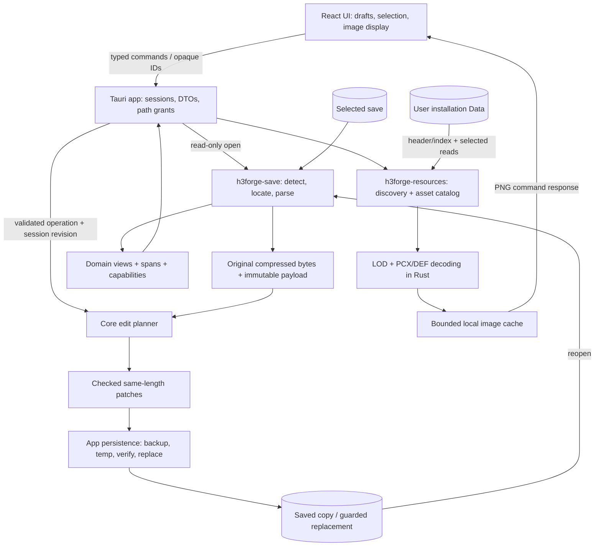

# H3Forge architecture

Status: proposed, 2026-11-08. Paths and Rust signatures below describe future implementation, not existing code. Evidence and limitations are centralized in [RESEARCH.md](RESEARCH.md).

## Decisions

Use one Cargo workspace, two reusable libraries and one thin desktop application. Domain definitions belong with the save library until a real second consumer needs a separate crate. Resource formats, installation discovery and image caching fit together in one resource library. Avoid a database, internal web server, plugin framework, generic serializer or seven-crate decomposition.

Use React + TypeScript + Vite with CSS design tokens and small accessible components. Follow FlightTrace's `web/src/{api,types,components,pages}` organization but use Tauri commands, not its Axum server. React state/reducers and a typed command wrapper are enough initially; no global state/query framework is required. Ship compiled web assets; Node/npm are development tools only.

## Proposed layout

```text
Cargo.toml                      # resolver 3, edition 2024, shared dependencies
Cargo.lock                      # committed; --locked in milestone checks
rust-toolchain.toml              # channel 1.99.1; rustfmt, clippy; minimal profile
crates/
  h3forge-save/
    src/{lib,error,container,detect,domain,definitions,locate,parse,edit,patch}.rs
    tests/                      # small synthetic tests + opt-in local fixtures
  h3forge-resources/
    src/{lib,error,lod,pcx,def,image,discovery,catalog,cache}.rs
    tests/
  h3forge-map/                  # H3F-021: read-only .h3m reader, discovery, matching
    src/{lib,error,container,reader,model,parse,discovery}.rs
    tests/                      # synthetic + opt-in sample map
apps/h3forge-desktop/src-tauri/
  Cargo.toml
  build.rs
  tauri.conf.json
  capabilities/main.json
  src/{main,commands,dto,session,persistence}.rs
web/
  package.json                  # exact direct versions + package-lock.json
  src/{api,types,components,pages,styles}/
licenses/                       # upstream notices when code is adopted
THIRD_PARTY_NOTICES.md
.local/                         # ignored private test copies and outputs
docs/
```

Workspace members include all three Rust packages; `default-members` are the two libraries so ordinary core tests do not pull in desktop tooling. Target Windows x86_64 MSVC first; ARM64 and other operating systems are future work. Do not create these implementation files during this planning session.

## Toolchain and Tauri 3 baseline

Pin Rust `1.99.1` in M0. The following deliberately uses a known release snapshot rather than floating `next` tags. Different alpha numbers are expected.

| Direct package/tool | Proposed exact pin | Evidence / status |
|---|---|---|
| `tauri` | `=3.0.0-alpha.5` | Official tagged workspace/release |
| `tauri-runtime-wry` | `=3.0.0-alpha.5` | Same workspace/release |
| `tauri-runtime` | `=3.0.0-alpha.4` | Explicit constraint added during M0: alpha.5 removes dispatcher methods still used by tauri/Wry alpha.5 |
| `tauri-build` | `=3.0.0-alpha.4` | Same workspace manifest |
| `@tauri-apps/api` | `3.0.0-alpha.3` | Same snapshot's API manifest and release |
| `@tauri-apps/cli` | `3.0.0-alpha.4` | Official published release; pin in frontend dev dependencies |

Sources: [tagged Cargo workspace](https://raw.githubusercontent.com/tauri-apps/tauri/tauri-v3.0.0-alpha.5/Cargo.toml), [API manifest](https://raw.githubusercontent.com/tauri-apps/tauri/tauri-v3.0.0-alpha.5/packages/api/package.json), [CLI release](https://github.com/tauri-apps/tauri/releases/tag/@tauri-apps%2Fcli-v3.0.0-alpha.4). Supporting runtime/macros/codegen/utils/build entries are alpha.4 in that snapshot; capture their compatible resolution in Cargo.lock. Do not use Cargo caret ranges to accidentally advance an alpha graph.

**Compatibility status (M0 completed, 2026-11-08):** both lockfiles are retained; the resolved graph contains no Tauri 2 packages. The user verified the frontend production build, Windows Cargo check, native launch and `get_app_info` response display. Retain the explicit runtime alpha.4 constraint: runtime alpha.5 removed methods still called by the selected tauri/Wry versions. Exact frontend and native-dialog selections are recorded in the root README. Future upgrades must verify the stack together.

Use Wry/WebView2, not bundled CEF. The v3 builder must explicitly select the runtime, conceptually `tauri::Builder::default().runtime(tauri_runtime_wry::Wry::default())`. Do not add the removed `tauri` `wry` feature or use `tauri::Wry`. Runtime-specific features belong to the runtime crate. [Official runtime guide](https://v3.tauri.app/develop/webview-runtime/)

Expose commands with `#[tauri::command]`, register with `generate_handler!`, and invoke through `@tauri-apps/api/core`. Use managed application state and structured serializable errors. Offload bounded parsing/decompression and disk operations from the UI thread. The native picker runs in Rust; the frontend receives an opaque grant/token, not a general filesystem capability. Avoid unnecessary Tauri plugins. [Calling Rust](https://v3.tauri.app/develop/calling-rust/)

Configure the main local window only, explicit command permissions/capabilities and a restrictive CSP. No remote navigation, frontend shell/HTTP/filesystem plugin, or wide asset protocol path scope. Native drop events can authorize a specific dropped save, after canonicalization and file-type checks. Neither command permissions nor a picker replace backend path validation. [Capabilities](https://v3.tauri.app/security/capabilities/)

## Components and data flow



1. A Rust picker/discovery/drop grants access to a save. App reads bounded bytes and creates a session. Core validates gzip integrity and content version, locates records and produces views plus diagnostic confidence. Failed/unsupported records cannot be edited.
2. UI selects a hero by session ID, not name. App requests a domain asset key; resources resolves a trusted archive entry/frame, decodes it, and returns PNG data. Missing assets leave the domain view usable.
3. UI sends semantic edit operations. Core validates capability, bounds and coupling, then constructs patches against the current payload. App advances the revision and returns the updated view/dirty summary.
4. Save captures one revision, verifies source/destination identity, creates backup and temporary output, validates the decompressed result and atomically commits where supported. The session becomes clean only after reread succeeds.

## Binary, domain, operations and DTOs

Keep these representations separate:

- `SaveDocument`: original compressed bytes, original decompressed payload, `DetectedFormat { family, major, minor, container_kind }`, record spans and diagnostics. File paths are an application concern. Gzip headers/trailers are tracked; reject unsupported multi-member/trailing-data cases initially rather than discard them silently.
- `LayoutId`: explicit version/layout definition and operation support. A recognizable family is not a write capability. `Compatibility` distinguishes verified edit support, readable/experimental and unsupported.
- `HeroId`/`TownId`: session-local stable record identifiers based on locator order/span. Duplicate names never select a record. Domain `HeroView` stores decoded values and typed unknown IDs; it need not be serde-shaped. Keep original name bytes, apply chosen legacy encoding for display, and do not offer name editing initially.
- `EditOperation`: examples `SetPrimary`, `SetMana`, `SetExperience`, `SetLevel`, `SetLearnedSpell`, `SetArmySlot`. Each operation declares affected fields and preconditions. Level/experience synchronization is an explicit action, not an incidental save normalization.
- `BytePatch { offset, expected, replacement, reason }`: equal lengths, checked bounds, no overlap, exact preimage match. Reject ambiguous records, stale revisions and unsupported operations. A spell operation can have multiple patches for learned/available state; allow no unrelated field changes.
- `HeroDto`, `SaveSummaryDto`, `FieldCapabilityDto`, `ChangeSummaryDto`, `AppErrorDto`: frontend-facing serde values owned by the app. No raw offsets, mutable binary buffers or disk paths are accepted as edit instructions. Map core errors to a stable code, human message and actionable details.

Core definitions should port IDs, skill/spell ordering and equipment relationships with provenance comments. Prefer checked slicing and integer arithmetic over pointer casts. No `unwrap`/`expect` on file-derived data. Enforce limits before allocations/decompression: initial configurable implementation constants of 64 MiB compressed save, 256 MiB payload, 100,000 LOD entries, 32 MiB decoded entry and 16 million image pixels are conservative proposals to validate against available fixtures. Return `LimitExceeded` rather than exhaust memory.

Commands can begin as `choose_save`, `open_granted_save`, `list_heroes`, `get_hero`, `apply_edit`, `reset_hero`, `discard_changes`, `choose_save_destination`, `save_session`, `choose_installation`, `list_saves`, and `get_asset`. Mutation requests include session ID and expected revision; save disables further mutations for its duration. One open save is sufficient for MVP. Structured errors include unsupported format/operation, corrupt input, ambiguous record, invalid value, changed source, permission denied, missing resource and failed replacement.

## Resource integration and discovery

Extract relevant mmarch Rust code into `h3forge-resources`; do not create a separate vendored CLI crate or require modifications to the sibling repository. Suggested API:

```text
LodReader::open(path, limits) -> Result<LodReader>
LodReader::entries() -> &[EntryInfo]
LodReader::read_entry(entry_id) -> Result<Vec<u8>>  # raw decompressed entry
decode_pcx(bytes, limits) -> Result<RgbaImage>
decode_def_frame(bytes, group, frame, palette_policy, limits) -> Result<RgbaImage>
AssetCatalog::resolve(DomainAssetKey) -> AssetSource | Missing
```

Reuse mmarch header/entry layout, decompression and PCX logic. Adapt startup to `Read + Seek` for header/directory only, then selected entry reads. Check offsets plus stored lengths against file length, reject short/invalid directories and duplicate-name ambiguities, and keep unknown entry names out of filesystem paths. No writer APIs. Do not inherit implicit PCX-to-BMP conversion or silent decode fallbacks.

DEF is new work: first decode the icon frames actually required, with checked group/frame tables, bounded RLE output, dimensions, crop offsets, palette indices and explicit transparency/shadow treatment. Extend only to encodings observed in requested assets; unknown encodings return a placeholder. Keep MM6 sprite decoding distinct. Preserve indexed palette semantics before RGBA conversion; a cyan-looking RGB color alone is not a universal transparency rule. Verify the selected frames visually on a checkerboard. Native Rust encodes PNG; MVP transfers bounded PNG bytes/base64 through a command and the UI displays them. A custom protocol is optional only if measured transfer costs justify it.

Installation candidates, in order: explicit stored selection, executable parent with `Data/`, then a **debug-only explicitly configured** development root. Prompt for a root if none validates. Use `current_exe()`, not current working directory, for portable placement. Validate archive signatures and report empty/unsupported archives. No registry scanning is necessary for MVP. Save discovery lists `Games/` within that root, case-insensitively, and recent authorized files; content detection follows opening, not extension alone. Do not recurse across the user's drives.

Resolve asset names case-insensitively with a declarative per-installation catalog. Proposed precedence is explicit local overrides (if later enabled), HotA extensions/localized overlays, HotA, expansion, base archives, but **actual precedence and matching icon IDs need fixture evidence** before enabling an override. For unknown/unsupported HotA-specific IDs, never use an unrelated base frame. The supplied `HotA.lod` is skipped with an unsupported-directory diagnostic until H3F-014 establishes its layout. Readable base and localized archives remain available.

Hero portraits require a verified identity-to-resource mapping; names alone and sorted list positions are inadequate. Keep portrait identity optional. H3F-005 validates at least one reference mapping and records unresolved/custom cases. Asset failure never changes save semantics.

Cache on demand in `%LOCALAPPDATA%/H3Forge/cache`, with a small in-memory LRU and optional bounded disk PNG cache (initial target 256 MiB disk). Key by canonical installation/archive identity, length/mtime plus directory fingerprint, entry ID/frame, palette policy and decoder version. Invalidate on archive change; skip caching failures except short-lived missing lookups. Cache writes never occur in the installation or repository `Data/`. Archive handles are read-only; size/identity checks reject concurrent replacement. No full extraction or preload.

## Save safety and persistence

1. Read-only first. Preserve the entire immutable payload and original compressed bytes. Unsupported versions, corrupt gzip, ambiguous spans and unexplained record lengths disable writes. Unknown IDs survive; they do not automatically invalidate unrelated proven fields.
2. Validate the specific operation against format capacity, domain limits and coupled state. MVP primary edits use conservative game-valid effective ranges; raw overflow values remain inspectable/preserved. Block unresolved equipment/bonus states rather than guessing. Spellbook creation and combination equipment are separate operations, outside the initial spell toggle.
3. Build the output by applying verified equal-length patches to the original payload. Test that every decompressed byte outside their union is identical. A no-op writes nothing. Recompression necessarily changes compressed bytes; byte-preservation claims refer to the payload.
4. Serialize saves per session. Re-read/check the source fingerprint and destination state; acquire appropriate Windows file access to limit concurrent writes and refuse game-locked files. A hash check alone is not a race-free lock. Save As is the default for early releases; new destinations must be created without overwriting a file that appeared in the meantime.
5. Before committing modifications, copy original compressed source bytes to a unique backup and verify the backup. If overwriting a different existing Save As target, require explicit overwrite selection and back up that target too. If backup creation fails, stop. Do not rotate/delete backups in MVP.
6. Write a uniquely named temporary file in the destination directory (same volume), flush/sync, close, decompress with integrity validation and compare to the intended payload. Reparse modified records and review the patch diff. Only then commit.
7. For existing files, use a reviewed Windows replacement implementation backed by `ReplaceFileW`, handling its documented partial-failure outcomes. Never delete the original to make rename succeed. New-file commit uses no-clobber behavior. Preserve recovery backups and report actual surviving paths after a failure; do not claim absolute power-loss durability. [Windows replacement API](https://learn.microsoft.com/en-us/windows/win32/api/winbase/nf-winbase-replacefilew)
8. Reread final output, then mark the saved revision clean. If this fails, retain the session's edits and backup information. Permissions, antivirus locks and changed files are recoverable errors, not reasons to retry destructive writes.

Development adds a hard destination guard for canonical repository `games/` and `Data/` (including aliases/junctions). Copy saves to `.local/fixtures/` or temp first. Production legitimately writes to the user's selected Games folder; this development restriction must not accidentally prohibit that normal use.

## Interface localization (H3F-024)

Implemented with bundled `en`, `ru`, `de`, `es` TypeScript catalogs, i18next 25.6.3 + react-i18next 16.3.5, English fallback and English-derived key types. Settings persists a UI-language override separately from legacy encoding. The narrowly permitted `get_ui_languages` app command uses sys-locale 0.3.2 to read Windows UI preferences. Rust supplies error codes, cause classifications and numeric parameters; broad read-only descriptors preserve exact technical details. Frontend translates summaries and sends bounded labels to Rust-owned native dialogs. UI language never controls save-name decoding, binary patches or game-name identity. `web/src/lib/legacyText.ts` retains its existing decoding behavior. The tested dependency graph preserves Tauri 3 Alpha pins. Inventory, game-catalog provenance policy, implementation details and pending native visual/relaunch checks are centralized in [H3F-024](issues/024-internationalization.md).

## Verification strategy

Use a few synthetic legal fixtures for gzip/header/range failures, representative LOD/PCX/DEF cases and field patches. Keep real sample copies private, opt-in via a fixture-root environment variable, and excluded from CI artifacts. Baseline its fingerprint and a few hero offsets/fields from research. Avoid checking in whole saves or game images, including upstream mmarch fixtures.

Each changed component gets focused tests. Milestone checks cover: sample read-only UI (M1), a portrait and icon plus absent-asset fallback (M2), byte-diff/backup/failure cases and one actual matching-game reload of the spell edit (M3), one representative workflow per added editor (M4), and one clean Windows packaged smoke test (M5). If the game is unavailable, record the game-load check as outstanding; never substitute parser round-trip success for it. No exhaustive cross-product matrix or repeated whole-project checks after minor edits.
